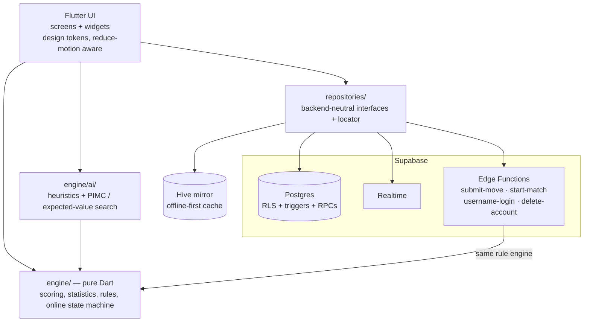

# Tarok Counter: Slovenian Tarok, scored, played and analysed

> **This repository holds no code.** It describes a project I designed and built
> alone. The source is in a private repository; I can walk through it in an
> interview.

**Live app:** <https://tarokcounter-6a9f8.web.app> (UI in Slovenian)

**Tarok Counter** (*Tarok Točkovnik*) is a cross-platform app for **Slovenian
Tarok**, a 4-player trick-taking card game with bidding, hidden partners,
announcements and some of the most complicated scoring of any card game. It
started as a digital score sheet and grew into a full product:

- a rule engine that scores every contract;
- computer opponents that use Monte-Carlo search;
- real-time online play, with the server enforcing the rules;
- public matchmaking with a rating system, profiles and achievements.

---

## Screenshots and video

> 📸 *Placeholders: replace the files in [`media/`](media/) and keep the names, or edit the links.*

| Score sheet | Playing table | Multiplayer lobby |
| :---: | :---: | :---: |
|  |  |  |

| Round results | Profile and achievements | Statistics |
| :---: | :---: | :---: |
|  |  |  |

**Demo video:** [▶ Watch on YouTube](https://youtu.be/VIDEO_ID) *(placeholder)*

<!-- Or embed a GIF:  -->

---

## At a glance

| | |
| --- | --- |
| **Role** | Sole developer: product, design, frontend, backend, AI, DevOps |
| **Timeline** | November 2025 – present (~520 commits) |
| **App code** | ~47,500 lines of Dart across 171 files |
| **Backend** | 34 Postgres migrations (~5,000 lines of SQL, RLS policies, RPCs, triggers, pg_cron), 4 Deno/TypeScript Edge Functions |
| **Tests** | ~800 Dart unit and widget tests (~16,700 lines) + SQL Row Level Security test suite |
| **Platforms** | Web (primary, Firebase Hosting), Android |
| **Budget** | Built entirely on free tiers, which was a hard design constraint |

---

## Features

### 1. Score sheet and rule engine (offline-first)
- You describe each round and the app computes the points. It covers every
  contract (Tri/Dve/Ena, Solo, Solo brez, Berač, Odprti berač, Valat, Klop),
  **napovedi** (announcements) with stacked kontra/rekontra, radelci, the Mond
  penalty, renons, zaruf and dealer rotation.
- Works with 3–5 players and custom scoring values per game.
- **Undo restores the statistics exactly**: the statistics engine is written as
  mirrored `applyRound` / `revertRound` pairs.
- Per-match and lifetime statistics dashboards.
- Works fully offline. A local Hive (IndexedDB) mirror with a flush queue syncs
  when the connection comes back.
- Share a sheet live with friends. Concurrent edits are resolved by
  compare-and-swap on a revision counter.

### 2. Play against the computer
- Every decision is made for real: bidding, king call, talon pick and discard,
  announcements and trick play, for every contract family.
- **Normal** bots play strategy heuristics distilled from a Slovenian Tarok
  strategy manual.
- **Hard** bots add **Perfect-Information Monte-Carlo (PIMC)** search. They
  sample hidden hands consistent with everything observed (voids, revealed
  partner, bidding) and pick the move with the highest expected score over
  those worlds.
- **Fairness boundary:** decision code receives only a `GameView.forSeat(...)`
  projection and can never read other hands. Difficulty comes from thinking
  harder, never from seeing more.

### 3. Real-time online play (server-authoritative)
- 4 players, dealt real hands, over Supabase Realtime. Empty seats are filled
  with bots.
- **The server runs the rules.** A Supabase Edge Function runs the app's own
  Dart engine (compiled to JavaScript), validates every move, plays the bots and scores the rounds.
  A player's hand never leaves the server except to that player.
- Players see their own card play instantly, and the server's state replaces
  it (or rolls it back if the move is refused).
- Presence detection, pause on disconnect, a turn timer that auto-plays a bot
  move for an idle player, and a full round-by-round replay of every move.

### 4. Public multiplayer, rating and progression
- A public lobby: create or join a match, a countdown start, choice of match
  length (8–40 rounds), and seats refilled by bots when someone leaves.
- **Two ratings, lifetime and monthly**, each with a leaderboard. The system
  is a custom Elo variant that I **validated by simulation** (300 simulated
  players, 6,000 matches, deal luck measured from the bots):
  - points scale with match length;
  - beating a stronger player is worth more;
  - losing to a new player costs nothing;
  - leaving a match carries an extra penalty.
- Profiles with tabs, ~20 achievements with bronze/silver/gold/diamond avatar
  tiers, friends, unique usernames, and an easter egg tied to losing the Mond.

### 5. Accounts and legal
- Email + password (confirmation and reset by code), Google sign-in, sign-in
  by username, and invisible Cloudflare Turnstile CAPTCHA.
- Account deletion with full data teardown, versioned terms of service and
  privacy policy (GDPR-minded: email addresses are never exposed to other
  users).

---

## Architecture

Design decisions:

- **One rule engine everywhere.** The engine is pure Dart with no Flutter
  imports. The score sheet, local AI games, the Edge Function and the bot
  research harness all run the same code, so there is no second implementation
  that could drift.
- **Clean backend boundary.** Screens, widgets, models and the engine import no
  backend SDK. Everything goes through `Repositories.*`. This made it possible
  to **migrate the whole backend from Firebase/Firestore to Supabase/Postgres**
  (July–September 2026) without rewriting the UI.
- **Security in the database.** Access control is Postgres Row Level Security
  plus BEFORE triggers. Ratings, match results and moves are written only by
  definer functions or Edge Functions, never by a client. A SQL test suite
  checks the policies.
- **No state-management framework.** Plain `setState` and streams, kept
  manageable by moving every rule out of the widgets into the testable engine.
- **Compact replays.** The move log is stored as card ids and short move
  strings, about 0.7 KB per round instead of about 11 KB, so every round of
  every game can keep its full replay.

---

## AI research: the "bot lab"

Making the bots stronger needed proper experiments, so I built an offline
research harness around the production engine:

- A **CLI tool** (compiled Dart executable, 8 worker processes) that plays
  thousands of **paired deals**: the same cards with the candidate in each
  seat, which cancels most of the card luck.
- An **opponent zoo** of 14 play-style archetypes (aggressive, soloist,
  klopper, gambler, rock…) and holdout tables, so a bot can't overfit to one
  kind of opponent.
- **CMA-ES parameter tuning** with strictly separate tuning and validation seed
  ranges. Only changes with a clear confidence interval on the validation
  seeds are shipped.
- **Real-game replay:** 365 rounds of real games from an online Tarok site,
  plus games played in the app, used to calibrate bidding and the belief
  model.
- Main measured result: expected-value bidding added **+3.4 to +4.0 points per
  deal**, the largest single gain. Flat PIMC card play added +0.5 to +0.8.
- Every experiment, rejected ideas included, is logged in a decision record
  with its confidence interval.

What I learned along the way: 400-deal runs are noise (about ±1 point per
deal), so every decision needs 2,000+ paired deals. Search ties fall back to
hand order unless they are broken on purpose. And a test that only asserts
equal totals can pass without checking anything.

---

## Tech stack

| Area | Technologies |
| --- | --- |
| Client | Flutter 3.38, Dart 3.9, Hive CE (offline store), Google Fonts, SVG |
| Backend | Supabase: Postgres (RLS, triggers, RPCs, pg_cron), Auth (GoTrue, PKCE, Google OAuth), Realtime, Edge Functions (Deno / TypeScript + the Dart engine compiled to JS) |
| Hosting | Firebase Hosting (web) |
| Security | Row Level Security, server-authoritative game state, Cloudflare Turnstile, rate limiting, enumeration-proof lookups |
| Observability | Sentry (crash reporting), PostHog (product analytics over HTTP) |
| AI | Heuristic policies, PIMC / determinization, expected-value decisions, Bayesian-style belief from actions, CMA-ES tuning |
| Quality | ~800 unit and widget tests, SQL RLS tests, `flutter analyze`, a benchmark gate for AI changes |

---

## Engineering highlights for reviewers

- **Moving to server authority without breaking clients:** online play went
  from "trusted host device" to "the Edge Function validates and applies every
  move" in staged, separately deployed steps.
- **Live database migration:** Firestore documents became a relational schema
  (`games`, `game_members`, `game_rounds`, …), and the 200-round document cap
  disappeared with it.
- **Backward-compatible data:** the scoring config is immutable and new fields
  are omitted at their default values, so years-old saved games still load and
  save.
- **Documentation:** architecture, security model, development guide, AI
  design document, roadmap and decision logs are maintained alongside the
  code.

---

## Contact

**Gaj Brus**: [GitHub](https://github.com/gajbrus) · *LinkedIn: add link* · *Email: add address*

Happy to give a code walkthrough or a live demo.
